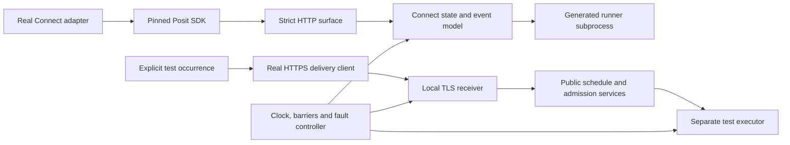

# Connect Simulation Design — Phase 0.60

Build a small stateful Connect simulator behind the real pinned Posit SDK,
then exercise the adapter with deterministic faults and a smaller set of real
local HTTPS and process-restart tests. Keep the simulator in `tests/rsconnect`.
It needs no Connect server, license, credentials, Quarto installation, Docker,
external database, or network access during execution.

This document is an implementation design. The research probe below is runnable;
the simulation modules and scenario suites are proposed. Passing them will
establish local simulated compatibility, not live Connect qualification. The
[0.60 preview release policy](IMPLEMENTATION_PLAN_0_60.md#preview-package-release)
continues to use local checks. Live-server comparison remains optional and does
not become a release prerequisite.

## Research Findings

Research used Posit documentation identifying itself as Connect **2026.10.0**,
the **0.17.0** SDK documentation and tagged source, and the current repository.
These are separate provenance dimensions, not a tested server/SDK support tuple.

| Source | Verified behavior | Consequence for the simulation |
|---|---|---|
| [S1: SDK schedule API](https://posit-dev.github.io/posit-sdk-py/reference/connect.schedules.html) | The API is experimental; each variant has at most one schedule. `create` also updates, and `delete` tolerates an absent schedule. `activate` concerns publishing rendered output. | Exercise actual SDK methods. Do not represent `activate=false` as pausing the timer. |
| [S2: tagged schedule implementation](https://github.com/posit-dev/posit-sdk-py/blob/v0.17.0/src/posit/connect/schedules.py) | `rule` decodes the `schedule` JSON string into per-type fields such as `N`. Top-level fields remain on the resource. SDK updates merge the old record into a full replacement request. | Store raw server records, distinguish server replacement from SDK merge, and test decoded resource shape. |
| [S3: scheduling guide](https://docs.posit.co/connect/user/scheduling/) | Failed renders have no automatic retry and do not shift cadence. Old successful output can remain visible. A past schedule start selects a future occurrence. Deployment rendering can be disabled. | Keep timer events, HTTP retries, render outcome, and published output distinct. Do not invent catch-up after failure. |
| [S4: content bundles](https://docs.posit.co/connect/user/content-bundles/index.html#failed-deployments) | Environment-build failure precedes activation. Some later deployment failures restore the previous bundle, with exceptions for missing predecessors and later activation. | Represent build, activation, render, and rollback as separate events; rollback must not undo a newer deployment. |
| [S5: SDK content](https://github.com/posit-dev/posit-sdk-py/blob/v0.17.0/src/posit/connect/content.py), [variants](https://github.com/posit-dev/posit-sdk-py/blob/v0.17.0/src/posit/connect/variants.py) | Schedule lookup resolves a default variant and checks rendered content mode. An unknown mode may be refreshed. | Exercise GUID versus numeric IDs, zero/multiple default variants, and unschedulable content. |
| [S6: environment API](https://docs.posit.co/connect/api/#get-/v1/content/-guid-/environment), [SDK implementation](https://github.com/posit-dev/posit-sdk-py/blob/v0.17.0/src/posit/connect/env.py) | GET lists variable names; PATCH changes selected values; PUT replaces the environment. | Never let an environment read expose secret values. Preserve unrelated values when disarming. |
| [S7: content settings](https://docs.posit.co/connect/user/content-settings/#environment-variables) | The documented environment includes content identity and credentials, but the reviewed list does not establish ETLantic nominal-slot/retry provenance. | Baseline renders receive no invented trusted occurrence. Treat process environment as a snapshot; changing configuration cannot rewrite an existing process. |
| [S8: script deployment](https://docs.posit.co/connect/user/scripts/), [CLI reference](https://docs.posit.co/rsconnect-python/commands/deploy/) | Script rendering uses Quarto. CLI quiet mode emits the final URL; warnings/errors can remain on stderr. | A CLI stand-in proves the subprocess boundary only. Cover ambiguous URLs/output without requiring Quarto. |
| [S9: late scheduled reports](https://docs.posit.co/troubleshooting/articles/scheduled-reports-are-not-running-on-time.html) | Capacity and an unfinished prior job can delay execution. This page's concurrency default differs from the current scheduling guide. | Require an explicit capacity in every profile; do not silently choose a universal vendor default or assume a backlog policy. |

Keep fixture provenance as `sdk-source`, `vendor-doc`, or `adversarial-assumption`.
An assumption is a fault model, never an assertion about real Connect behavior.
For undocumented backlog, restart replay, read visibility, and queue ordering,
exercise several permitted fault profiles instead of inventing one authoritative
implementation. No simulator field may be treated as a vendor-provided context
field unless a reviewed source establishes it.

## Current Coverage And Regressions

The pre-fix focused baseline passed **38 tests**. The regression set covers the
package, trigger contract, and schedule service with the pinned real SDK:

```bash
uv run --no-sync --with posit-sdk==0.17.0 pytest -q tests/rsconnect \
  tests/control_plane/test_trigger_0_59.py \
  tests/service/test_schedule_application_0_57.py
```

The existing adapter tests replace `PositSdkGateway` with a class whose
`create_or_update()` returns the request dictionary as `schedule.rule`.
Delivery unit tests replace `_request` and commonly hold monotonic time constant.
Deployment tests replace subprocess execution. These are useful unit tests,
but cannot establish SDK serialization, socket deadlines, TLS, or crash recovery
on their own. The additional transport tests use actual verified loopback TLS
with the real client and generated runner subprocess.

The new review regressions add a barrier-controlled two-caller schedule race,
completed-state-only pending recovery, stale/unsupported amendment preflight,
inherited `CONNECT_INSECURE` override, and receipt mutations checked against the
public CP1 parser. These local cases cover the reported failures; they do not
claim a stateful Connect emulator or production crash campaign.

The [offline SDK probe](evidence/phase_0_60/probe_sdk_shape.py) uses the real
`posit-sdk==0.17.0`, `PositSdkGateway`, and `ConnectScheduleAdapter.inspect_drift`.
Only the Requests transport is replaced by a strict synthetic response table;
unexpected requests fail and neither HTTP scheme reaches the network.
Its [recorded result](evidence/phase_0_60/sdk_shape_probe.json) is:

```json
{
  "sdk_rule": {"N": 1},
  "adapter_expected": {
    "type": "hour", "n": 1,
    "start_time": "2026-10-13T13:00:00Z",
    "timezone": "UTC", "email": false
  },
  "adapter_status": "drifted"
}
```

The captured result confirms a source-level compatibility defect: a matching
SDK schedule was reported as drifted. The adapter now normalizes the SDK's
decoded `rule["N"]` together with the resource's type, start time, timezone, and
email fields. The added regression passes against the real SDK shape, and the
new [post-fix probe result](evidence/phase_0_60/sdk_shape_probe_after_fix.json)
reports `in_sync`. The original result remains unchanged as historical evidence.

The regression set also fixes related risks:

- The binding now retains the immutable remote recurrence anchor separately
  from the advancing canonical `next_fire_at` cursor; a regression advances
  the cursor and verifies the unchanged SDK schedule remains in sync.
- The runtime client and generated runner cap socket requests at
  `max_attempts`, including when DNS returns several addresses. A deterministic
  multi-address failure test verifies the runtime cap. Separate runtime tests
  prove that stalled DNS and credential resolution share the elapsed deadline.
- The TLS transport remains accessible after `HTTPConnection` transfers a
  closing response to `HTTPResponse`. Actual verified loopback TLS tests drip
  response headers, chunk-size lines, and trailers across the deadline, for
  closing and persistent connections. The generated runner subprocess also
  covers closing chunked responses. Cleanup closes response and transport
  handles explicitly. Full TLS-error/rebinding and process-recovery campaigns
  remain proposed below.
- Release-shell simulations verify an independently versioned preview artifact
  and simulate duplicate-upload recovery using that artifact's version. They
  contact no package registry and publish no artifact.
- The independent release tag is checked against package metadata, the module,
  the lockfile, the root extra, and package release notes. Installed-wheel tests
  clear pytest's workspace `pythonpath`; the base-wheel checker verifies import
  origins and runs generated content with `python -I -S`, so source imports or
  development dependencies cannot hide packaging errors.

## Test Architecture



There is deliberately no baseline edge from the generated runner to the receiver:
the current generated bundle has no trusted occurrence provider and must refuse
armed delivery. Positive delivery composition uses an explicit fixture occurrence
through the public client. The report must identify which path actually ran.

### Layer 1 — SDK Contract Surface

Use `connect.Client(url=..., api_key=...)` and the real `PositSdkGateway`.
Fast tests mount a strict Requests adapter on both HTTP schemes. Socket tests
use the same state model through a loopback HTTPS server. Both frontends return
raw JSON and let the installed SDK construct its own resources and exceptions.
The synthetic transport is test-only; production never gains simulator selection.

Implement only routes used by the pinned SDK, including a configurable URL
prefix. The schedule routes below are SDK implementation details with an
experimental label, not stable public REST promises. Unknown routes/methods
fail the test rather than returning a permissive success.

| Route below `<prefix>/__api__/` | Simulator responsibility |
|---|---|
| `GET v1/content/{guid}` | Content mode/identity; query parsing; missing/forbidden content; refresh after deployment. |
| `GET applications/{guid}/variants` | Variant records with distinct numeric `app_id` and `id`; exactly one default in the valid profile. |
| `GET variants/{id}/schedules` | Raw schedule list, not the adapter's desired request dictionary. |
| `POST schedules` | Validate content/variant ownership; assign remote identity; enforce one schedule per variant; apply create defaults. |
| `POST schedules/{id}` | Validate required fields and replace writable fields; omitted values follow the pinned profile, so SDK merge behavior is actually tested. |
| `DELETE schedules/{id}` | Remove only that timer; allow a 404 race after lookup; retain content and prior run records. |
| `GET/PATCH/PUT v1/content/{guid}/environment` | Return names only; patch selected entries or replace all entries; fail cross-content authorization. |

Raw fixtures must be authored from the source ledger, reviewed independently of
adapter output, and tagged `synthetic`. Include extra server fields, absent/null
fields, invalid JSON strings, wrong types, and noncanonical timestamps. Preserve
the experimental warning in at least one contract test. Test `activate` separately
from timer existence and `ETLANTIC_TRIGGER_ARMED`.

### Layer 2 — Deterministic State And Fault Model

Keep the following state separate:

| Entity | Important fields |
|---|---|
| Content | GUID, owner/scope, app mode, active bundle, environment revision, render-on-deploy setting. |
| Bundle | Immutable hash, build/deploy state, previous bundle, deployment operation identity. |
| Variant | Numeric ID, application ID, default flag, at most one schedule, most recent successful output. |
| Schedule | Remote ID, recurrence type/parameters, immutable anchor, timezone, email/output flags, next nominal event. |
| Render task | Cause (`deploy`, `scheduled`, `manual`, `rollback`), queued/start/end times, bundle/environment snapshot, outcome. |
| Binding/journal | Host-owned pending/active/paused/deleted state, full-record CAS, operation ID, revision/generation. |
| Canonical firing | Owned exclusively by ETLantic's existing public services/stores. The simulator must not reimplement deduplication or admission. |

Use a virtual UTC clock for scheduling and a separate monotonic clock for
timeouts. Advances process an ordered heap `(due_time, sequence, event)`;
explicit barriers select concurrent interleavings. The sequence only makes a
test reproducible; it does not assert vendor queue ordering. Persist nominal
events across simulator restart when that profile requires it. Cap generated
events so large time jumps cannot produce an unbounded test.

For the supported UTC interval subset, calculate expected cadence independently:
`anchor + k * interval`, with explicit cases just before, at, and after a slot.
Do not call the adapter's recurrence conversion to derive simulator expectations.
Use the public canonical clock separately as the ETLantic-side oracle. Initially
reject cron/local-time/calendar support claims; DST and other content variants
are negative capability tests. A 90-minute schedule is supported by the vendor
but currently rejected by the adapter: retain that bounded-scope expectation
until the product deliberately widens its interval translation.

The documented baseline has no automatic retry of a failed render. Repeated
HTTP sends occur inside one delivery; a new scheduled render represents another
slot. Forced task replay is an explicitly adversarial profile. Capacity blocking,
manual refresh, clock skew, and downtime must not create invented authorized
occurrences. Backlog profiles (`defer`, `drop`, `coalesce`) are robustness probes
where exact vendor behavior is unknown, with safety assertions across all three.

Fault control addresses a named operation and boundary, for example:

```yaml
case: SIM060-L02
operation: schedule.create
boundary: after_remote_commit_before_response
effect: drop_response
restart: adapter_process
expect:
  remote_schedule_count: 1
  local_binding: pending_until_verified
  permitted_recovery: readback_before_retry
```

Required boundaries are before remote application; after remote application but
before reply; after reply but before local commit; before/after environment
change; and before/after canonical admission/effect recording. A timeout after
commit must retain remote state. Every injected fault must record that it fired;
a scenario whose injection was never reached is a failure, not a pass.

For host binding/journal recovery, implement a test-only SQLite store conforming
to the public protocols, with transactionally checked full-record CAS. In-memory
mode is sufficient for ordinary state tests. Process-kill tests reopen the same
on-disk store in a fresh process; serializing a dictionary after an orderly exit
is not a crash test. This fixture is not a new supported persistence provider.

### Layer 3 — Real Local Transport And Canonical Admission

Run a small standard-library HTTPS receiver using the public envelope parser,
`ScheduleApplicationService.trigger_external`, and authorized receipt lookup.
Bind test credentials to `ControlPlaneContext` before body processing. Use the
existing application preparation/admission services for positive accepted work;
do not manufacture accepted receipts in the receiver or copy a deduplication
algorithm into the harness.

Use memory stores for service-contract cases and public
`etlantic_sqlmodel.control_plane` stores against an isolated SQLite file for
applicable persistence cases. Reuse existing store conformance tests. Run required
test schema setup explicitly against that disposable file. Where a public store
does not support the needed transition, report a local implementation gap and
use a narrower test; do not substitute a successful toy store and claim recovery.
SQLite results do not claim PostgreSQL locking or production-store semantics.

The HTTPS server must support disconnect-after-admission, truncated/chunked and
slow responses, oversized headers/bodies, wrong media types, and redirect sinks.
Use an ephemeral test CA with hostname verification enabled; lock a test-only
certificate-generation dependency during implementation. Trust it only in the
test process/children through their CA configuration. Cover wrong-host, untrusted,
and expired certificates without turning verification off. Explicitly enable
both loopback and private-address policy where required by the current IP
classification; include default-deny cases.

Do not replace `HttpsTriggerDelivery._request` in these tests. Control DNS at the
resolver boundary while retaining real connect/TLS/read behavior. Prove the dialed
address and TLS hostname, and count requests received by a second endpoint to
detect redirect/auth leaks. Separate deterministic retry arithmetic from short
real-time timeout tests; use generous measured tolerances and hard watchdogs for
the latter. Freeze neither real socket time nor monotonic time in socket tests.

### Layer 4 — Generated Content, CLI And Process Boundaries

Extract the actual generated archive and run its bytes in a fresh Python
interpreter with a minimal environment. Recheck the manifest before and after.
The default mode, every render cause, and the armed-without-provider mode must
produce zero receiver requests. Include prepopulated `ETLANTIC_SCHEDULED_AT`
and attempt/correlation variables: their presence must not bypass the absent
provider. The existing modified-config helper test is only a codec test.

For positive composition, a separate fixture supplies `OccurrenceContext` to
`HttpsTriggerDelivery`. It is explicitly trusted by the test receiver and labeled
`test_occurrence_provider`. Never patch the generated manifest/config to manufacture
an end-to-end Connect success. Generated-runner positive coverage can be added
only when a real provider seam exists, with its own tests.

A fake `rsconnect` executable tests real subprocess invocation, the sanitized
environment boundary, manifest handling, exit codes, timeout, process death, and
stdout/stderr parsing. It applies deployment events to simulator state and can
commit before dying. Inspect only allowlisted environment names and redact
credential values in all traces. This does not prove Quarto rendering or actual
CLI publishing. A separate local parser-contract test with pinned
`rsconnect-python==1.31.1` verifies the CLI flags; a future tool-version change
updates that profile explicitly. Full Quarto smoke tests are optional.

Use separate adapter, receiver, and executor processes with barrier handshakes.
Hard-kill the relevant process at a named boundary and verify durable state from
another process before restart. An executor failure after a 200 admission receipt
must remain ETL failure/unknown in canonical status. For duplicate-effect tests,
use one explicitly idempotent or transactional local fixture sink; do not assert
exactly-once behavior for arbitrary external effects.

## Scenario Matrix

P0 is the first local regression suite to implement; P1 expands recovery and
sequence exploration. All rows below are planned, not currently passing evidence.
`AC` refers to the corresponding AC060 production criterion; simulated coverage
contributes evidence but does not close that live qualification item.

| ID | Priority / layer | Stimulus | Required oracle / AC |
|---|---|---|---|
| SIM060-C01 | P0 / SDK | Real SDK hourly record round-trip | Matching whole resource is `in_sync`; changed N/type/timezone/email is drift; malformed/unreadable fields never arm. AC002/004. |
| SIM060-C02 | P0 / SDK | Update existing schedule; omit optional fields; switch type | SDK preserves intended fields, server replacement semantics apply, stale type parameters cannot leak. AC002/004. |
| SIM060-C03 | P0 / SDK | Missing/two default variants; interactive or unknown app mode | Correct refresh/rejection, no guessed default or mutation of unrelated content. AC001/004. |
| SIM060-C04 | P0 / SDK | Delete missing timer; lookup/delete race; 401/403/500 | Only documented absence is benign; authorization and uncertain writes stay distinguishable. AC004/005. |
| SIM060-C05 | P0 / SDK | URL prefix, numeric IDs versus GUIDs, foreign content | Exact route/scope; unrelated content, environment, and timer unchanged. AC004/005. |
| SIM060-T01 | P0 / clock | UTC minute/hour/day slots; equal-time boundaries | Independent expected slots, no wall-clock rounding; unsupported specs reject before writes. AC002. |
| SIM060-T02 | P0 / clock | Accept first slot, advance canonical cursor, inspect/pause timer | Original cadence is not mistaken for drift merely because admission progressed. AC002/004. |
| SIM060-T03 | P0 / clock | Fail render, then advance to next slot | No automatic render retry; cadence and last successful output remain distinct. AC002/003. |
| SIM060-T04 | P1 / clock | Capacity 1/2, long render, restart/downtime, three backlog profiles | No unauthorized slot; missed work visible; no unsupported delivery/liveness claim. AC002/003. |
| SIM060-L01 | P0 / state | Register/apply/pause/resume/delete with owned deployment | Valid full-record transitions; deny new canonical admissions before remote stop; retained runs survive. AC004/006. |
| SIM060-L02 | P0 / state | Schedule commits, response disappears, adapter restarts | Pending intent persists; readback before retry; at most one owned timer; uncertainty is visible. AC003/004. |
| SIM060-L03 | P0 / state | Each disarm/write/readback/arm/local-commit boundary fails | No unverified active claim; failed cleanup remains explicit uncertainty, not assumed disarmed. AC004/005. |
| SIM060-L04 | P0 / state | Two operators race from the same record | Atomic CAS leaves one claimed operation; a loser cannot replace or disarm it; reconciliation only finalizes a matching completed remote state. AC004. |
| SIM060-L05 | P1 / state | External edits; stale readback; missing remote resource | Inspect is read-only; no blind overwrite/adoption/recreate on ambiguity. AC004. |
| SIM060-L06 | P1 / process | Amend or rollback while render is already running | Old environment snapshot may still send; canonical revision/generation fencing controls new admission. AC003/004. |
| SIM060-L07 | P1 / state | New bundle fails after activation; newer deployment races rollback | Correct active bundle/output history; no resurrection of an invalidated timer binding. AC004. |
| SIM060-D01 | P0 / CLI | Success URL, URL without GUID, multiple GUIDs, warning-only stderr | Correlate only proven owned deployment; ambiguity persists; secrets never surface. AC004/005. |
| SIM060-D02 | P0 / CLI/process | Publish commits then times out/dies; journal commit fails | Remote content is retained with uncertain outcome; restart cannot silently create a duplicate. AC004. |
| SIM060-R01 | P0 / runner | All render causes disarmed/armed; spoofed context variables | Actual untouched generated bundle submits nothing without provider. AC002/005. |
| SIM060-R02 | P0 / runner | Tampered manifest/config, unsafe archive paths, undeclared files | Validate and reject before deployment/execution; reproducible bundle digest. AC001/005. |
| SIM060-H01 | P0 / HTTPS | Admit then drop response; retry after next cursor advances | Same occurrence and submission; retained canonical receipt proves recovery. AC003. |
| SIM060-H02 | P0 / HTTPS | 202 pending, 200 accepted without run ID, skipped receipt | No pending-as-accepted or receipt-as-ETL-success claim; correct authorized lookup. AC001/006. |
| SIM060-H03 | P0 / HTTPS | Wrong scope/revision/generation, expired/revoked credential | New admissions denied; receipt access follows canonical authority; bounded redacted failures. AC003/005. |
| SIM060-H04 | P0 / HTTPS | 429/503, delta/date/invalid Retry-After, exhausted retry budget | Same semantic envelope, advancing monotonic clock, bounded sleeps and attempts. AC003/005. |
| SIM060-H05 | P0 / HTTPS | Multiple addresses, DNS/connect/read stalls, slow drip | Count socket attempts and retry rounds; total/request deadlines include elapsed work; no hidden multiplier. AC005. |
| SIM060-H06 | P0 / HTTPS | Bad TLS, redirects, alternate host, DNS rebinding | Real certificate/hostname verification; no second-origin credential leak; dial only approved addresses. AC005. |
| SIM060-H07 | P0 / HTTPS | Duplicate/unknown fields, wrong correlation/media type, invalid lengths, oversized chunks | Bounded read and strict parsing; invalid observations never become admission success. AC005. |
| SIM060-H08 | P0 / HTTPS | Encoded schedule ID, base path, hostile status reference | Prefix and escaping preserved; reconciliation stays on authorized receiver routes. AC001/005. |
| SIM060-P01 | P1 / process | Kill receiver after durable admission, before receipt | Fresh process finds retained work; one submission mapping for fixture occurrence. AC003/006. |
| SIM060-P02 | P1 / process | Kill executor before/after fixture effect and result publication | Known/unknown effect recorded correctly; no unsupported replay or invented success. AC006. |
| SIM060-P03 | P1 / process | Pause/delete while an already-started render sends | New work rejected at canonical cutoff; historical admission and allowed lookup retained. AC003/004. |
| SIM060-S01 | P0 / all | Synthetic sentinel credentials in failures, stdout, traces, artifacts | Scan emitted bytes; no values in manifests, journal, diagnostics or CI artifacts. AC005. |
| SIM060-S02 | P1 / stateful | Generated operation/fault sequences and shrunk counterexamples | All invariants hold after each step; exact replay log retained. AC002–006. |

## Invariants And Simulator Quality

Assert properties of remote state, local durable state, and canonical admission,
not merely method call order:

1. One owned timer per bound variant; ownership never follows display-name matches.
2. No fresh submission for unbound or unauthorized occurrences. Repeated valid
   deliveries retain one canonical submission mapping, even after cursor movement.
3. Old revision/generation cannot authorize new work after cutoff. Retained
   occurrence lookup follows the public service's rules rather than a new rule
   invented by the simulator.
4. A pending intent remains durable after a crash. Retry can finalize a matching
   completed remote state without repeating the mutation; an incomplete or
   mismatched operation stays pending for operator reconciliation.
5. Timer state, render outcome, receipt state, and ETL/effect outcome remain separate.
6. Bounded attempts, elapsed time, response bytes, and queues hold under faults.
   Count retry rounds, connections, and sends separately in the evidence.
7. Secrets and unrelated resources remain untouched; all faults and cleanup
   failures appear in the result rather than being silently ignored.

Use [Hypothesis stateful tests](https://hypothesis.readthedocs.io/en/latest/stateful.html)
for action sequences over the fast model: deploy/register/apply, advance time,
change recurrence, pause/resume/delete, edit remote state, lose responses, restart,
and revoke credentials. Start with 50 examples × 30 steps for pull requests;
run larger locally reproducible campaigns periodically. These are proposed budgets,
not measured runtimes. Generate schedules and fault choices independently from
the adapter, retain minimized examples, and promote every defect to a named
deterministic regression.

Test the simulator itself with immutable golden records and transition tables.
Run the same model scenarios through both the in-process and HTTPS frontends;
compare normalized event traces. Add deliberate defective-adapter mutations
(wrong N, new slot on retry, pause skipped, redirect followed, secret logged)
and verify the relevant regression fails. An all-green suite that cannot detect
these faults is not sufficient. Avoid `xfail` entries that turn known P0 gaps
into claimed passing coverage.

## Files, CI, And Evidence

Proposed files:

```text
tests/rsconnect/simulation/
  model.py                 # content/variant/timer/render transitions
  clock.py                 # deterministic events and barriers
  http_surface.py          # strict SDK routes; two transport frontends
  faults.py                # named before/after-commit injections
  stores.py                # test binding/journal CAS storage
  receiver.py              # public service adapter; no new admission logic
  processes.py             # bounded subprocess lifecycle and restart control
  fixtures/                # synthetic raw records, source ledger, clock vectors
tests/rsconnect/test_sdk_contract.py
tests/rsconnect/test_simulated_lifecycle.py
tests/rsconnect/test_simulated_clock.py
tests/rsconnect/test_https_transport.py
tests/rsconnect/test_process_recovery.py
tests/rsconnect/test_simulation_stateful.py
```

Do not create an installable simulator package or place vendor behavior in core.
Reuse Hypothesis already present in the dev group. Add a locked test group for
`posit-sdk==0.17.0`, the CLI parser contract, and test certificate tooling; none
belongs in the generated runner's dependency closure. Required simulator jobs
must fail if their test dependencies are missing instead of silently skipping.
Dependency installation is ordinary setup, not external service qualification.

Recommended CI split:

- Fast SDK/state/clock tests on Python 3.11–3.13; keep plain unit tests on the
  existing OS matrix. Initial fast-suite target: under one minute.
- Local TLS and process recovery on Linux initially, with a bounded macOS/Windows
  spawn smoke test. Initial job target: under five minutes, with per-case
  watchdogs. Only claim the process behaviors actually exercised per OS.
- Installed-wheel smoke in a clean environment, excluding source `PYTHONPATH`;
  verify no FastAPI/Data Mover/engine imports and an untouched generated runner.
- Larger stateful campaigns using saved seeds and operation logs. Real Connect
  capture/differential tests, when available, remain optional follow-up work.

No suite reads developer Connect credentials. Bootstrap children with an explicit
environment and ephemeral test credentials. Allow only test-owned loopback
addresses, use per-test ports/directories, and install the network guard in child
processes too. An isolated-interpreter runner may use a standard-library guard
bootstrap outside the bundle; record this instrumentation without modifying the
bundle. Fail if outbound traffic, leaked processes, or untriggered faults remain.

Each result records scenario ID, layer, evidence kind, assumption profile,
package/SDK versions, source and wheel/bundle hashes, seed, nominal and observed
times, fault boundary, whether it fired, redacted HTTP method/path/status,
before/after state fingerprints, assertions, cleanup result, and disposition.
Do not record authorization headers, environment values, source rows, or raw
vendor stderr. Historical research results include source hashes so later fixes
do not silently rewrite the meaning of the captured mismatch.

## Implementation Order

1. **Correct SDK conformance:** implemented the SDK readback normalization,
   stable recurrence anchor, and deterministic multi-address attempt bound.
   The strict probe and focused regressions pass. Actual SDK mutation routes,
   TLS, and the remaining lifecycle scenarios are still pending.
2. **Build deterministic failure coverage:** model content/timer/render state,
   CAS ownership and journals, then add all P0 lifecycle/CLI/runner cases.
3. **Exercise actual local I/O:** HTTPS receiver using public services, actual
   socket/certificate cases, installed-wheel smoke, and bounded deadline tests.
4. **Add process recovery and sequence exploration:** independent processes,
   disposable durable stores, kill barriers, all P1 cases, and mutation checks.

For each increment, record implemented/passed/failed/deferred scenarios explicitly.
Only local implemented regressions join the preview release checks. No
increment requires a live Connect server or changes the phase's
external-qualification deferral.
